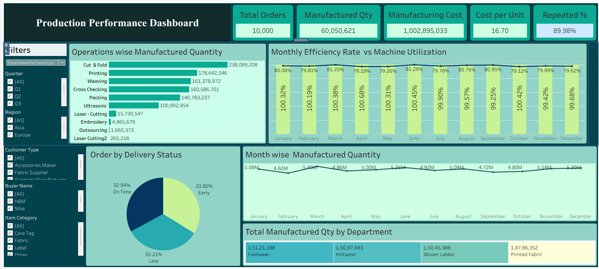
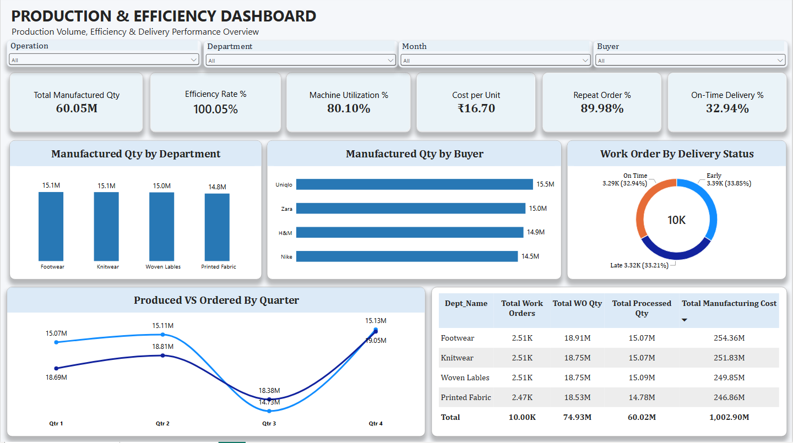

<div align="center">

## 📌 Project Overview

This project focuses on analyzing manufacturing operations to evaluate production performance, manufacturing efficiency, product quality, delivery performance, and operational costs.

The project follows an end-to-end data analytics workflow, starting with raw data cleaning and transformation using **Excel and Power Query**, followed by relational database development and SQL analysis using **MySQL**. Interactive dashboards are developed using **Excel, Power BI, and Tableau** to transform manufacturing data into meaningful business insights.

The analysis covers production quantities, work orders, machine utilization, rejection rates, department performance, buyer delivery performance, and manufacturing costs.

## 🎯 Business Objectives

The primary objective is to transform manufacturing data into actionable insights that support operational monitoring and data-driven decision-making.

Key objectives include:

* 🏭 Analyze overall production output and work order performance.
* ⚙️ Evaluate production efficiency and machine utilization.
* 📉 Monitor rejected quantities, rejection rates, and wastage.
* 🏢 Identify high-performing departments and manufacturing operations.
* 👨‍🏭 Analyze employee-wise and machine-wise production quality.
* 🚚 Evaluate buyer-wise delivery performance.
* 💰 Monitor manufacturing costs and cost per unit.
* 📊 Develop interactive dashboards to communicate business performance.

## 🔍 Key Areas of Analysis

| Analysis Area        | Focus                                                                      |
| -------------------- | -------------------------------------------------------------------------- |
| Production Analytics | Work orders, ordered quantity, processed quantity, and manufactured output |
| Efficiency Analytics | Production efficiency and machine utilization                              |
| Quality Analytics    | Rejected quantity, rejection rate, and wastage                             |
| Department Analytics | Department-wise production and rejection performance                       |
| Machine Analytics    | Machine utilization, output, and rejection performance                     |
| Employee Analytics   | Employee-wise production and quality performance                           |
| Delivery Analytics   | Early, on-time, and late deliveries                                        |
| Cost Analytics       | Manufacturing value and cost per unit                                      |


## 🛠️ Tools & Technologies

The project uses multiple data analytics and business intelligence tools to perform data preparation, database management, SQL analysis, and interactive data visualization.

| Category                   | Technology      | Purpose                                              |
| -------------------------- | --------------- | ---------------------------------------------------- |
| 📊 Spreadsheet Analysis    | Microsoft Excel | Data exploration, analysis, and dashboard creation   |
| 🧹 Data Cleaning           | Power Query     | Data cleaning, transformation, and preprocessing     |
| 🗂️ Data Modeling         | Power Pivot     | Data modeling, table relationships, and calculations |
| 🗄️ Database              | MySQL           | Relational database creation and data storage        |
| 🔎 Query Language          | SQL             | Data validation, KPI analysis, and business insights |
| 📈 Business Intelligence   | Power BI        | Interactive dashboards and data visualization        |
| 📊 Data Visualization      | Tableau         | Interactive analytical dashboards                    |
| 🔧 Version Control         | Git             | Project version management                           |
| 🐙 Repository              | GitHub          | Project hosting and documentation                    |
| 💻 Development Environment | MySQL Workbench | SQL development and database management              |


## 📂 Repository Structure

The repository is organized into separate folders to maintain a clear separation between datasets, documentation, SQL scripts, dashboards, and visual assets.

```text
Manufacturing-Analytics/
│
├── 📁 Data/
│   ├── Cleaned_Manufacturing_Data.xlsx
│   └── Manufacturing_Data_Uncleaned.xlsx
│
├── 📁 Docs/
│   ├── AXon_Manufacturing_Analytics_KPI_Cheat_Sheet.pdf
│   ├── Column_Description_Of_Manufacturing_Data.docx
│   ├── KPI_Metrics_List.xlsx
│   └── Project_Overview.md
│
├── 📁 Excel/
│   └── Production_&_Quality_Dashboards.xlsx
│
├── 📁 Images/
│   ├── 01_Manufacturing_Analytics.png
│   ├── 02_ER_Diagram.png
│   ├── 03_Production_Dashboard.png
│   ├── 04_Quality_Dashboard.png
│   ├── 05_Production_Dashboard.png
│   └── 06_Quality_Dashboard.png
│
├── 📁 PowerBI/
│   └── Production_&_Quality_Dashboard.pbix
│
├── 📁 SQL/
│   ├── 01_Database_Setup_&_Import.sql
│   ├── 02_KPI_Analysis.sql
│   ├── 03_Business_Insights.sql
│   ├── 04_Advanced_SQL_Analysis.sql
│   └── 05_Views_and_Stored_Procedures.sql
│
├── 📁 Tableau/
│   └── Production_&_Quality_Dashboards.twbx
│
└── 📄 README.md
```


## 🔄 Project Workflow

The project follows an end-to-end data analytics workflow, covering data preparation, database development, SQL analysis, and business intelligence reporting.

```text
        📂 Raw Manufacturing Data
                  |
                  ▼
        🧹 Data Cleaning & Transformation
              (Excel / Power Query)
                  |
                  ▼
           🗂️ Data Modeling
              (Power Pivot)
                  |
                  ▼
          🗄️ MySQL Database
        (8 Dimension + 1 Fact Table)
                  |
                  ▼
          🔍 SQL Data Analysis
                  |
          ┌───────┼────────┐
          ▼       ▼        ▼
       KPI     Business  Advanced
     Analysis  Insights   SQL
          |       |        |
          └───────┼────────┘
                  ▼
        👁️ SQL Views & Stored Procedures
                  |
                  ▼
          📊 Dashboard Development
                  |
          ┌───────┼────────┐
          ▼       ▼        ▼
        Excel   Power BI  Tableau
          |       |        |
          └───────┼────────┘
                  ▼
          💡 Business Insights
```

### 📌 Project Execution Stages

| Stage                    | Description                                                                            |
| ------------------------ | -------------------------------------------------------------------------------------- |
| 1. Data Preparation      | Explored, cleaned, and transformed raw manufacturing data using Excel and Power Query. |
| 2. Data Modeling         | Organized data into dimension and fact tables using Power Pivot.                       |
| 3. Database Development  | Created a relational MySQL database and imported the cleaned datasets.                 |
| 4. Data Analysis         | Performed exploratory analysis, KPI calculations, and business analysis using SQL.     |
| 5. Advanced SQL          | Applied CTEs, window functions, ranking, and analytical queries.                       |
| 6. SQL Reusability       | Developed reusable SQL views and stored procedures.                                    |
| 7. Dashboard Development | Built interactive dashboards using Excel, Power BI, and Tableau.                       |
| 8. Business Insights     | Analyzed manufacturing performance to identify trends and areas for improvement.       |


## 🧹 Data Preparation & Cleaning

Data cleaning and transformation were performed using **Excel and Power Query** to prepare the manufacturing dataset for analysis.

* Removed blank placeholder rows.
* Standardized column names and data types.
* Applied text-cleaning and transformation operations.
* Organized data into dimension and fact tables.

### 📊 Data Cleaning Summary

| Metric             | Records |
| ------------------ | ------: |
| Original Records   |  10,679 |
| Blank Rows Removed |     679 |
| Final Records      |  10,000 |


## 🗄️ Database Design

The project uses a relational MySQL database named `axon_mfg`, consisting of  **8 dimension tables and 1 fact table** .

### 📋 Database Tables

* **Dimension Tables:** Buyer, Customer, Date, Department, Employee, Item, Machine, Operation.
* **Fact Table:** Production.

### 🔗 Entity Relationship Diagram


## 📊 Key Performance Indicators (KPIs)

The project evaluates 19 KPIs across production, efficiency, quality, delivery, and operational performance.

* Total Work Orders
* Total Ordered Quantity
* Total Produced Quantity
* Total Processed Quantity
* Efficiency Rate
* Machine Utilization
* Total Manufacturing Cost
* Cost per Unit
* Average Per-Day Machine Cost
* On-Time Delivery Percentage
* Repeat Order Percentage
* Total Rejected Quantity
* Rejection Rate
* Wastage Percentage
* Total Wastage Percentage
* Employee-wise Rejected Quantity
* Machine-wise Rejected Quantity
* Operation-wise Rejected Quantity
* Department-wise Manufactured vs. Rejected Quantity

## 🧠 SQL Analysis & Skills

The project demonstrates SQL skills across multiple levels:

**Database Fundamentals**

* Database and table creation
* Data import and validation
* Aggregate functions and filtering

**Intermediate SQL**

* Joins and subqueries
* GROUP BY and HAVING
* CASE statements

**Advanced SQL**

* Common Table Expressions (CTEs)
* Window Functions
* RANK(), DENSE_RANK(), ROW_NUMBER()
* LAG() and running totals
* SQL Views and Stored Procedures

## 📋 Business Questions Solved

* Which departments have the highest production?
* Which month records the highest manufacturing output?
* Which operations generate the most rejections?
* Which machines have higher rejection quantities?
* Which buyers have better on-time delivery performance?
* Which employees contribute to higher rejection quantities?
* How does manufacturing performance vary across departments?

## 📈 Dashboard Development

The project includes interactive dashboards developed using three visualization tools.

### Excel Dashboards

Production and Quality analysis using Excel PivotTables, charts, and interactive filters.

### Power BI Dashboard

Interactive reporting for manufacturing production and quality performance.



### Tableau Dashboards

Production and Quality dashboards for visual exploration of manufacturing performance.



## 💡 Key Business Insights

The analysis identified the following findings:

* Total manufacturing output: **60,050,621 units**.
* Total rejected quantity: **491,023 units**.
* Production efficiency: **100.05%**.
* Machine utilization: **80.10%**.
* On-time delivery rate: **32.94%**.
* Repeat order rate: **89.98%**.
* Total manufacturing value: **1,002,895,033.40**.

## 🚀 How to Run the Project

### 1. Clone the Repository

```bash
git clone https://github.com/SantiSomaSekhar/Manufacturing-Analytics.git
```

### 2. Prepare the Data

Use the cleaned dataset available in the `Data/` folder.

### 3. Execute SQL Scripts

Run the SQL files in MySQL Workbench in this order:

```text
01_Database_Setup_&_Import.sql
02_KPI_Analysis.sql
03_Business_Insights.sql
04_Advanced_SQL_Analysis.sql
05_Views_and_Stored_Procedures.sql
```

### 4. Explore the Dashboards

Open the Excel, Power BI, and Tableau files from their respective folders.

## 🎯 Key Skills Demonstrated

* Data Cleaning & Transformation
* Excel & Power Query
* Power Pivot & Data Modeling
* MySQL & Advanced SQL
* KPI Development
* Business Analysis
* Power BI & Tableau
* Data Visualization
* Git & GitHub

## 📚 Documentation

Additional project documentation is available in the `Docs/` folder:

* **Project Overview**
* **KPI Cheat Sheet**
* **KPI Metrics List**
* **Column Description**

## 👨‍💻 Author

**Santennagari Soma Sekhar**

🔗 [GitHub](https://github.com/SantiSomaSekhar)

## 📄 License

This project is available under the MIT License.

---

<div align="center">
